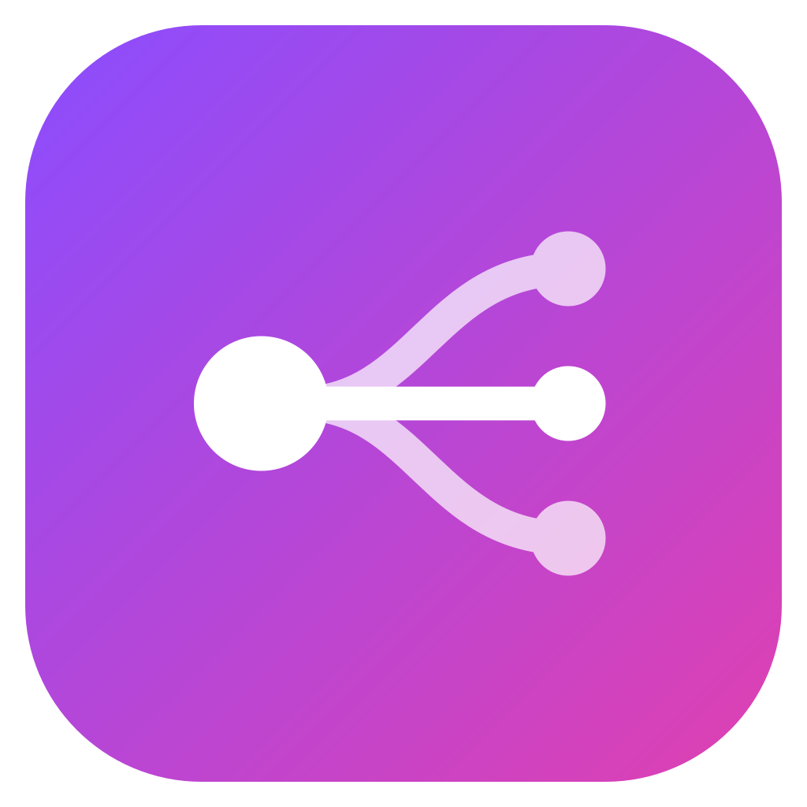

<p align="center">
  
</p>

<h1 align="center">HangarAI</h1>

<p align="center">
  <b>Run a team of coding agents in one native window, and steer them from your phone.</b><br>
  <sub>Claude Code and Codex (beta), side by side. Either one is enough.</sub>
</p>

<p align="center">
  <a href="https://github.com/BlasterWhite/hangar/releases/latest"></a>
  <a href="https://github.com/BlasterWhite/hangar/actions/workflows/ci.yml"></a>
  <a href="LICENSE"></a>
  
</p>

<p align="center">
  <a href="#install">Install</a> ·
  <a href="docs/guide/README.md">Guide</a> ·
  <a href="CHANGELOG.md">Changelog</a> ·
  <a href="https://hangarai.dev">Website</a> ·
  <a href="https://discord.gg/hangarai">Discord</a>
</p>


Hangar is an open-source native desktop app written in Rust (no Electron). It runs your coding
agents — **Claude Code** and **Codex** (beta) — side by side in real terminals, as many sessions
as you need, and lets them work together: an orchestrator of either agent plans on a shared
board and hands tasks to workers of either agent, with a shared memory. It starts the agents
already on your machine, with your own accounts; one of them installed is enough, and a pane
can also be a plain shell. No telemetry, ever. Everything works with no account; an
optional Hangar account (Settings › Hangar account, off by default) links your machines and
syncs your usage statistics between them. Until you sign in, nothing leaves your PC. Once you
do, and only if you turn the sync on, Hangar sends totals per machine, day, model and project
name (tokens, active time and cost), never a path, a prompt or any code. What is sent, and how to
delete it, is on the [privacy page](https://hangarai.dev/privacy.html).

## What it does

- 🖥️ **Many agents, one window.** Up to 16 terminals per workspace, Claude Code, Codex or any
  shell, each showing whether its agent is working, waiting for you, or done.
- 📋 **A shared board and memory over MCP.** Agents claim tasks atomically, leave notes,
  and record what the next session should know.
- 🧭 **Orchestrator and workers, of either agent.** One agent plans, Claude Code or Codex;
  workers, of the same agent or the other, each get a git worktree and a branch. Every
  delivery is merged in a scratch worktree, run through your check command, read by a
  reviewer agent, then landed locally. Hangar never pushes.
- 🤝 **Delegate.** An agent hands a sub-task to the other one — a review, a question about
  the repository, a set of images — and gets the result back, with no board task.
- 🎨 **Images from Codex.** What a Codex session draws shows in the chat, on your phone and
  on Discord; a Claude Code orchestrator can ask Codex for images and use the files.
- 📱 **Hangar Mobile.** See what waits for you, answer your agents' questions with a tap,
  allow or deny permissions — from your phone, over your own Tailscale network.
- 🧩 **Kits and previews.** Kits add skills, MCP servers and tabs of their own; agents show
  you images, code, Markdown, PDFs, web pages, video and 3D models beside their terminal.
- 🎙️ **Dictation.** Hold a key and speak; whisper.cpp transcribes locally.

More: [features](docs/guide/features.md) · [orchestration](docs/guide/orchestration.md) ·
[Codex (beta)](docs/guide/codex.md) · [MCP tools](docs/guide/mcp.md) · [privacy](docs/guide/privacy.md)

## Claude Code and Codex

Hangar asks each agent what it can do, never which agent it is, so every feature works with
either one alone, and says so where one does less:

| | Claude Code | Codex (beta) |
|---|---|---|
| Orchestrator, workers, project manager | yes | yes |
| Delivery reviewer | `claude -p` | `codex exec`, read-only |
| Chat view, answers from Mobile and Discord | yes | yes; keys checked on screen when Hangar cannot attach |
| Context gauge, plan limits | yes | yes, exact, with their reset times |
| Several accounts | yes | yes |
| Kits | everything | MCP servers; skills and hooks once added to Codex; commands and agents: Claude Code only |
| Usage statistics | yes | yes |
| Generates images | no | yes |
| `delegate`, as the one asked | yes | yes |

The full table, read from the code (`AgentInfo` in `crates/hangar-core/src/agent.rs`), and
what Hangar does when it cannot attach to Codex: [Codex (beta)](docs/guide/codex.md).

Codex support is **beta** until its users confirm it. Hangar was written against the protocol
OpenAI publishes for Codex, without a recorded session, and relies on a few things only
Codex's source shows: that Codex's own terminal draws a turn Hangar started, that it resumes
a session through Hangar's server, that the first of two answers to an approval wins, and how
an image is written in its newer session files. On Windows, Codex panes run without Hangar
attached for now ([what that changes](docs/guide/codex.md#attached-or-the-plain-terminal)).
Something wrong in a Codex pane? Use the
[Codex bug form](https://github.com/BlasterWhite/hangar/issues/new?template=codex-bug.yml).

## Install

This fork ships no prebuilt installers yet, and its builds do not update themselves:
build it from source (see [Build from source](#build-from-source)), then pull and build
again for a new version.

| System | How |
|---|---|
| Linux (x86_64) | Build the binaries, then the `.rpm` or `.deb` with [`crates/hangar-app/packaging/linux/build.sh`](crates/hangar-app/packaging/linux/build.sh) ([packaging guide](docs/native/PACKAGING.md)), or run `./target/dist/hangar-ai` straight from the build |
| Windows (x64) | [Build it from source](#build-from-source) |
| macOS (Apple Silicon + Intel) | [Build it on your Mac](#build-on-macos) |
| NixOS / Nix | `nix run github:BlasterWhite/hangar` (builds `main`), or the flake in your config: [NixOS](docs/guide/install.md#nixos-and-nix) |

You also need [Claude Code](https://code.claude.com/docs/en/overview) or
[Codex](https://learn.chatgpt.com/docs/codex/cli) (or both), installed and signed in; Hangar
offers to install them with their makers' installers. Then create a workspace
(`Ctrl`/`Cmd`+`Shift`+`N`): it starts with one agent pane, its orchestrator, Claude Code or
Codex as you choose. Tell it what you want built.

SmartScreen, Gatekeeper, WebKitGTK, upgrading from 1.x, first steps:
[install guide](docs/guide/install.md). Phone setup (about a minute):
[Hangar Mobile](docs/guide/mobile.md).

### Build from source

```bash
git clone https://github.com/BlasterWhite/hangar && cd hangar
scripts/native-dev.sh             # builds and runs Hangar on data of its own
cargo test --workspace
```

Requirements (Rust, cmake, clang, per-OS packages) and the repository layout:
[build guide](docs/guide/building.md).

### Build on macOS

On a Mac (Apple Silicon or Intel, macOS 10.15+), build Hangar yourself:

```bash
xcode-select --install                 # clang and the SDK
brew install cmake node pnpm           # cmake for dictation; node + pnpm for Hangar Mobile
curl https://sh.rustup.rs -sSf | sh    # Rust

git clone https://github.com/BlasterWhite/hangar && cd hangar
pnpm install && pnpm mobile:build      # optional: the phone app Hangar serves
cargo build --profile dist --locked -p hangar-app
cargo build --profile dist --locked -p hangar-webview --features engine
./target/dist/hangar-ai
```

`--release` instead of `--profile dist` builds several times faster (a bigger, slightly
slower app). To make a `Hangar.AI.app` and a `.dmg`: `crates/hangar-app/packaging/macos/build.sh`
([packaging guide](docs/native/PACKAGING.md)). A build of your own does not update itself:
pull and build again for a new version.

## Experiments

Off by default, under **Settings › Experiments**:
**chat view** (talk to the orchestrator instead of watching panes, shown above) ·
**nodes** (a headless `hangar-node` on a Linux machine over SSH, [design](docs/native/nodes.md)) ·
**pane scopes** (Linux: each pane in its own systemd scope, so a runaway build is stopped, not Hangar).

## Performance

Hangar 2.0 against 1.12.1, the last web-view release, on the same Linux machine: cold start
0.57 s vs 0.96 s; 16 terminals printing non-stop take 249 MiB vs 8.1 GiB.
[Benchmark](docs/native/BENCHMARK.md).

## Contributing

Ideas and questions on [Discord](https://discord.gg/hangarai); bugs and pull requests on
GitHub — start with [CONTRIBUTING.md](CONTRIBUTING.md) and the
[code of conduct](CODE_OF_CONDUCT.md). A bug in a Codex pane: the
[Codex bug form](https://github.com/BlasterWhite/hangar/issues/new?template=codex-bug.yml).
Security issues: [SECURITY.md](SECURITY.md).

## 💝 Contributors

<table>
  <tr>
    <td align="center" width="25%">
      <br/>
      <b>simnJS</b><br/>
      <i>Creator</i><br/>
      <sub>He/Him/Femboy</sub><br/>
      <a href="https://simnjs.fr">Website</a> / <a href="https://github.com/simnJS">GitHub</a>
    </td>
    <td align="center" width="25%">
      <br/>
      <b>Kisakay</b><br/>
      <i>Contributor · NixOS</i><br/>
      <sub>She/Her</sub><br/>
      <a href="https://github.com/Kisakay">GitHub</a>
    </td>
    <td align="center" width="25%">
      <br/>
      <b>McSon2</b><br/>
      <i>Contributor · macOS</i><br/>
      <sub>He/Him</sub><br/>
      <a href="https://github.com/McSon2">GitHub</a>
    </td>
    <td align="center" width="25%">
      <br/>
      <b>SimonB44470</b><br/>
      <i>Contributor · Accounts</i><br/>
      <sub>He/Him</sub><br/>
      <a href="https://github.com/SimonB44470">GitHub</a>
    </td>
  </tr>
</table>

## License

[MIT](LICENSE) © simnJS
